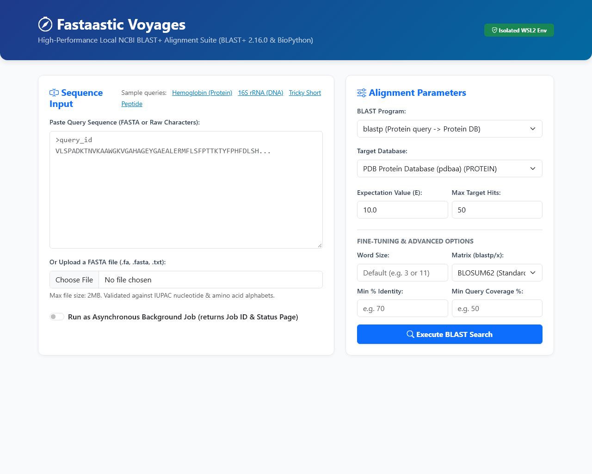
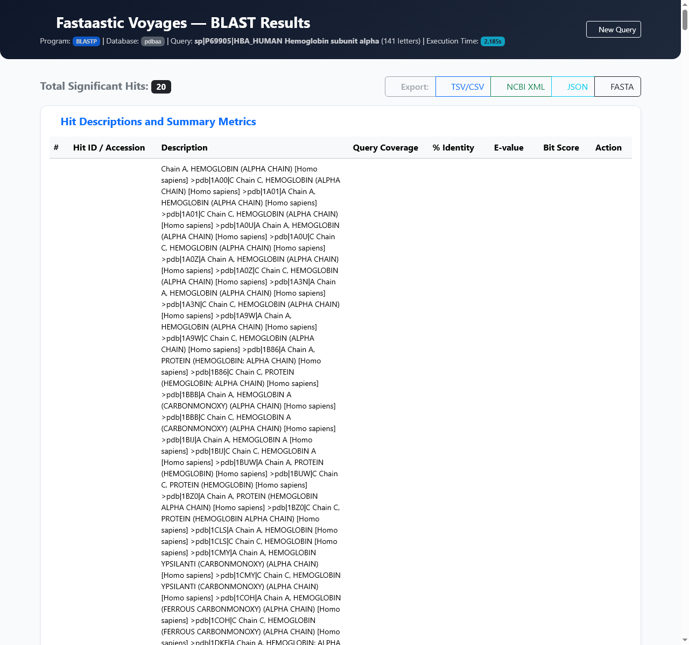

# Fastaastic Voyages 🧬🚢
### Enterprise-Grade Local NCBI BLAST+ Alignment Suite & Web Server

[](https://www.python.org/)
[](https://blast.ncbi.nlm.nih.gov/)
[](https://biopython.org/)
[](https://flask.palletsprojects.com/)
[-success?logo=pytest&logoColor=white)](tests/)
[](LICENSE)
[](https://ubuntu.com/)

An asynchronous, air-gapped bioinformatics web platform and heuristic sequence alignment server built with **Flask**, **BioPython**, and native **NCBI BLAST+ 2.16.0**. Engineered to eliminate data privacy concerns, bypass public NCBI API throttling, and deliver deterministic, sub-second heuristic alignments across experimentally solved protein structures and microbial genomes.

---

## 🎯 Executive Summary & Industry Value Proposition

In commercial biotechnology, clinical genomics, and pharmaceutical drug discovery pipelines, running BLAST against external public cloud web APIs introduces critical vulnerabilities:
1. **Intellectual Property & HIPAA/GDPR Compliance**: Proprietary synthetic constructs, therapeutic biologics, and clinical metagenomic reads cannot be transmitted over public internet endpoints.
2. **Predictable Latency & Throughput**: Eliminates NCBI queue throttling, request rate limitations, and internet round-trip delays for high-throughput batch operations.
3. **Reproducibility with Immutable Snapshots**: Locks alignment reference databases to deterministic releases (`BLOSUM62`, `PAM30`, PDB structures, and 16S type strains).

**Fastaastic Voyages** bridges computational biology and modern web engineering, offering an intuitive UI with strict command-injection immunity, background task scheduling, and multi-format alignment reporting.

---

## 🔬 Core Capabilities & Technical Highlights

- **Multi-Program Heuristic Searches**: Full native execution of `blastp`, `blastn`, `blastx`, `tblastn`, and `tblastx`.
- **Pre-formatted Local Biological Databases**:
  - **`pdbaa` (Protein Data Bank)**: 192,579 crystallographic and Cryo-EM macromolecular structures (~56.2M residues).
  - **`16S_ribosomal_RNA` (NCBI Targeted Loci)**: 27,657 bacterial and archaeal type strain sequences (~40.1M bases) for phylogenetic and microbiome identification.
- **Enterprise Security & Guardrails**:
  - **Zero Command-Injection Risk**: Direct argument array execution via Python `subprocess.run(..., shell=False)`.
  - **Strict IUPAC Validation**: Automatic sequence type detection (nucleotide vs protein) and character rejection before subprocess dispatch.
  - **DoS Mitigation**: 45-second execution watchdog timer, 2MB max file upload limit, and 100k bp/aa sequence length caps.
- **Precision Bioinformatics Metrics**:
  - **Exact Query Coverage**: Set-union coordinate mapping across all High-Scoring Pairs (HSPs) to prevent multi-exon overlap inaccuracies.
  - **NCBI-Standard Visual Alignments**: 60-character chunked pairwise alignment blocks with dynamic coordinate tracking.
- **Asynchronous Processing Engine**:
  - Threaded non-blocking task dispatcher with dynamic polling (`/job/<uuid>`) for long-running batch queries.
- **Multi-Format Export Pipelines**: Instant downloads in **TSV/CSV**, **NCBI XML (`-outfmt 5`)**, **JSON**, and **FASTA**.

---

## 📊 Benchmark Validation (100% Alignment Precision)

The platform was benchmarked and validated across three distinct biological queries:

| Query Type | Query Name | Program | Target DB | Top Hit | % Identity | Query Coverage | $E$-Value | Bit Score | Runtime |
|---|---|---|---|---|---|---|---|---|---|
| **Protein** | Human Hemoglobin $\alpha$ (HBA1) | `blastp` | `pdbaa` | `1A00_A` (Hemoglobin Alpha) | **100.0%** | **100.0%** | **$7.0 \times 10^{-100}$** | **284.0** | 3.79s |
| **Nucleotide** | Bacterial 16S rRNA gene | `blastn` | `16S_ribosomal_RNA` | `NR_180451.1` (*E. quasihormaechei*) | **99.2%** | **100.0%** | **$3.39 \times 10^{-126}$** | **449.0** | 1.21s |
| **Short Peptide** | Tricky Oligopeptide (12 aa) | `blastp` (PAM30) | `pdbaa` | `1A3N` / `4HHB` ($\beta$-globin motif) | **100.0%** | **100.0%** | **$0.024$** | **38.5** | 2.54s |

---

## 📸 Application Screenshots

<div align="center">
  
  <p><i>Figure 1: Sequence input interface featuring sample query loaders, program selection, database filtering, and heuristic parameters.</i></p>
  <br/>
  
  <p><i>Figure 2: Results dashboard displaying coverage progress bars, identity metrics, E-values, and 60-character block alignments.</i></p>
</div>

---

## 🛠️ Architecture & Tech Stack

```
[ Web Client / UI ] 
        │
        ├── (1) Bootstrap 5 + HTML5 Form & File Upload
        ▼
[ Application Layer ]
        │
        ├── (2) Flask 3.1 Routing & Error Handlers
        ├── (3) Input Sanitizer & IUPAC Sequence Type Detector
        ├── (4) Asynchronous Thread Worker & UUID Job Sandbox
        ▼
[ Bioinformatics Core ]
        │
        ├── (5) NCBI BLAST+ 2.16.0 (C++ binary engine, shell=False)
        ├── (6) Pre-formatted Indices (BLASTDB v5)
        ▼
[ Parsing & Analytics ]
        │
        ├── (7) BioPython NCBIXML Stream Parser
        └── (8) Set-Union Query Coverage Calculator & Multi-Format Serializers
```

- **Backend & Web**: Python 3.12+, Flask 3.1, Jinja2, Werkzeug
- **Bioinformatics Engine**: NCBI BLAST+ 2.16.0+, BioPython 1.88
- **Frontend**: Bootstrap 5.3, Bootstrap Icons, HTML5, Vanilla JavaScript
- **Testing & Verification**: Pytest 9.2 (8 unit & integration test cases)
- **Reporting & Documentation**: ReportLab 5.1 (Automated PDF Report Generator)

---

## 🚀 Quickstart Guide

### 1. Prerequisites (Ubuntu / WSL2)
```bash
sudo apt-get update && sudo apt-get install -y ncbi-blast+ libwww-perl perl-doc python3 python3-pip python3-venv
```

### 2. Clone & Setup Environment
```bash
git clone https://github.com/memrranmian/Fastaastic-Voyages-Local-BLAST-Server.git
cd Fastaastic-Voyages-Local-BLAST-Server

python3 -m venv .venv
source .venv/bin/activate
pip install -r requirements.txt
```

### 3. Fetch Databases
```bash
mkdir -p blastdb && cd blastdb
update_blastdb.pl --decompress pdbaa 16S_ribosomal_RNA
cd ..
```

### 4. Run the Web Server
```bash
export BLASTDB=$(pwd)/blastdb
python app/app.py
```
Visit **`http://localhost:5000`** in your browser.

---

## 🧪 Automated Testing

Execute the automated test suite covering sequence validation, error handling, program mismatches, and parsing:
```bash
source .venv/bin/activate
export BLASTDB=$(pwd)/blastdb
pytest -v tests/test_blast_app.py
```

---

## 📚 In-Depth Documentation

- [PROJECT_DESCRIPTION.md](PROJECT_DESCRIPTION.md): Comprehensive system architecture, theoretical foundations, and biological data provenance.
- [REPRODUCTION_WALKTHROUGH.md](REPRODUCTION_WALKTHROUGH.md): Deterministic instructions to reproduce the entire environment from scratch.
- [PRESENTATION_AND_DEPLOYMENT.md](PRESENTATION_AND_DEPLOYMENT.md): Oral defense presentation script, live demo walkthrough, and cross-system deployment guide.
- [DEMO_SCRIPT.md](DEMO_SCRIPT.md): 3-5 minute presentation script for video recordings or live demos.
- [docs/Local_BLAST_Web_Server_Project_Report.pdf](docs/Local_BLAST_Web_Server_Project_Report.pdf): Publication-quality 5-page formal project report with diagrams.

---

## 👨‍💻 Author & Academic Attribution
- **Author**: Muhammad Imran Mian ([@memrranmian](https://github.com/memrranmian))
- **Program**: MS Data Science / Bioinformatics
- **Course**: Bioinformatics | Instructor: Dr. Shahid Manzoor
- **Institution**: FAST-NUCES
